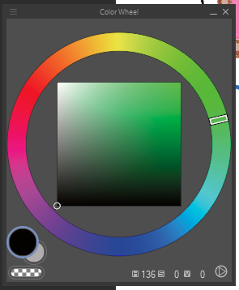
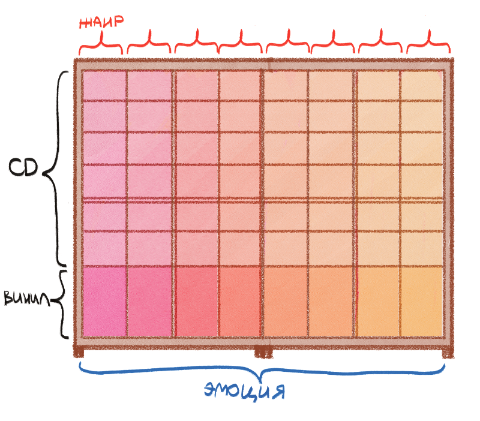
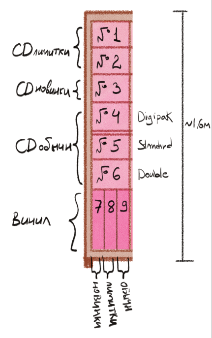
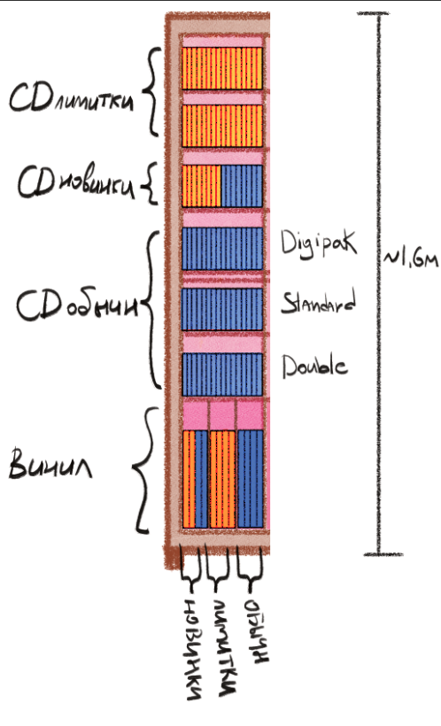
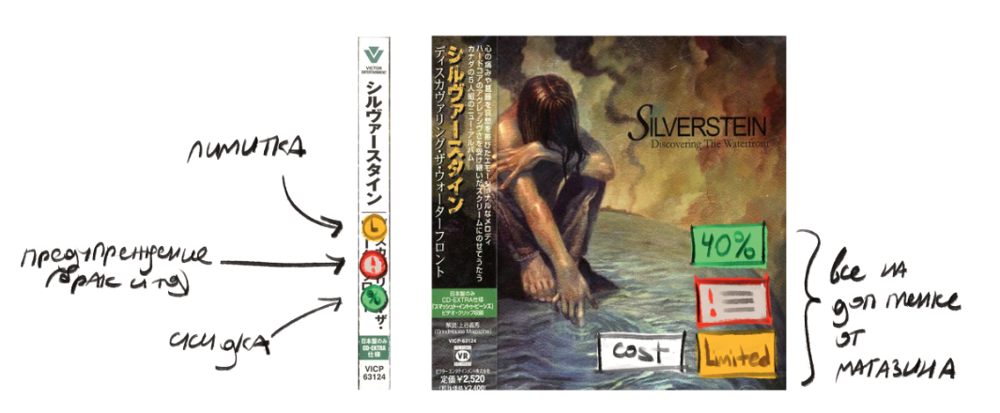

# Этап 1: cбор и анализ требований
## Магазин CD и винила - "Ferrets Love Rock"

>Дисклеймер: я выделила в пункт "Вода" свои мысли и более подробные обьяснения/ ненужные комментарии, которые явно не нужны в отчете, но нужны мне, их читать необязательно, по сути они  дублируют всю информацию, но менее официальным языком.

## 1. Описание предметной области

Магазин **"Ferrets Love Rock"** специализируется на розничной продаже музыкальных релизов на физических носителях: компакт-дисках (CD) и виниловых пластинках (Vinyl) с акцентом на альтернативные жанры (постхардкор, металкор, эмо, панк, альтернативная электроника).

> ### вода
> Возможно я придумала велосипед, из-за отсутвия опыта.. Но, так как я слушаю очень большой обьем музыки круглосуточно, меня всегда беспокоила её систематизация. Жанры/поджанры слишком обобщенная вещь, поэтому логично, что в Википедии под каждый альбомом/группой стояло несколько жанров, а мне хотелось точную систему в плейере. Точной добиться легко - класть песни в каждый жанр/поджанр, но тогда происходит дублирование, удобство и простое ориентирование реализовать куда сложнее.

> В итоге я придумала систематизацию по эмоциям. А именно на спекторе эмоций, взяв за основу цветовой круг. Он один из основных интрументов в рисовании, дизайне, а его смысл довольно прост - противоположности напротив, схожие рядом.Так же я решила организовать систематизацию в магазине - противоположные стеллажи противоположные эмоции и жанры, соседние - ближайшие.

Торговый зал имеет радиальную планировку, где стеллажи расположены по кругу. В магазине реализована эмоционально-жанровая система зонирования, основанная на цветовом круге: противоположные стеллажи представляют противоположные эмоции/жанры, а соседние — близкие по настроению.

> ### вода
> Каждый стеллаж - отдельная эмоция, например одиночество, отрешонность, умиротворение в этом стеллаже может лежать эмбиент, инди рок. 

> С ним граничит стеллаж тихого колючего одиночестива, где находиться находястя такие жанры как мидвест эмо и так плавно стеллажи уходят  до постхардкора, DSBM, а затем и вовсе дэд-металла.
> А с другой стороны стеллаж эмбиянта граничит со спокойным одиночеством, такие жанры как пост-рок, шугейз, а затем граничат с другими стеллажами и жанрами в них, доходя до электронники и более эксперсивныхх жанров.
> А замыкается электроника и дэд металл между собой смежными жанрами, и эмоцями, когда человек уже настолько ушел в агрессию что начинается протест, игру - треш металл,хардкор - панк, а с другой стороны эксперссивная электроника (например Prodigy) плавно переходит в электро - панк. И в итоге кольцо эмоций и жанров сходится на классическом панке.

Каждый физический стеллаж привязан к конкретной эмоции и разделен на вертикальные секции (вертикали), отвечающие за определенные жанры/поджанры, и горизонтальные полки. Каждая полка имеет уникальный идентификатор (ID), формируемый из номеров стеллажа, вертикали и полки.

Благодаря такой системе хранения человек может легко открывать для себя новые жанры в самом магазине, а не в интернете.

### Система хранения внутри стеллажа:

- **Верхние полки (CD):** разделены по категориям на лимитированные издания (лимитки), новинки и обычные издания. Внутри категории «обычные» CD сортируются по формату упаковки (Digipak, Standard, Double).
- **Нижние полки (Винил):** предназначены для пластинок и разделены на вертикальные ячейки (новинки, лимитки, обычные).

> ### Вода
> я рассчитала высоту стеллажа и расставила содержание полок так чтобы лимитки сразу бросались в глаза и были визитной карточкой...хе-хе точно не самое главное в БД...

### Сортировка экземпляров

Каждый экземпляр товара (конкретный диск или пластинка) имеет индивидуальный штрихкод и относится к одной из категорий состояния/продажи: обычный, лимитированный, скидка, категория уценки (физический брак/ неофициальный релиз). Категорию присваивает сотрудник приемки или администратор при поступлении товара. На основе категории на защитную пленку наносится соответствующая цветовая маркировка (наклейки магазина).

> ### Вода
> Заводская пленка имеет ценность при коллекционировании, поэтому дополнительная пленка от магазина будет одеваться и поверх заводской пленки. Так заводская пленка убережтся от клея и наклеек магазина.

> Неофициальные релизы  будут идти со скидкой, и если человек не коллекционер - это отличная возможность магазина продать, а покупателя - получить музыку по более дешевой цене.

### Система интегрирована с внешним **API Discogs**. 

При приемке товара сотрудник сканирует заводской штрихкод, после чего данные об исполнителе, альбоме и конкретном прессе (издании) автоматически заносятся в локальную БД. Внутренний учет контролирует точные остатки товаров на полках по координатам адреса хранения (стеллаж-вертикаль-полка). Сотрудники оформляют продажи, а администраторы управляют структурой зала, контролируют перемещения между полками, списывают критический брак (когда совсем уж нерабочее) и формируют аналитические отчеты по продажам.

### Ключевые процессы

| Процесс | Шаги | Что меняется в данных |
| :--- | :--- | :--- |
| **Регистрация покупателя** | Клиент предоставляет ФИО и телефон -> кассир оформляет карту лояльности. | Создаётся запись в «Покупатели», присваивается ID карты. |
| **Поиск музыкального релиза** | Покупатель или сотрудник ищет альбом по названию, жанру или эмоции (стеллажу). | Чтение каталога; данные в базе данных не меняются. |
| **Приемка товара (Discogs API)** | Сканирование заводского штрихкода -> автозаполнение из Discogs -> администратор выбирает внутренний жанр из фиксированного списка -> генерация внутреннего штрихкода. | Создается запись в «Релизы» и новые «Экземпляры» со статусом «На складе». |
| **Приемка неофициальных релизов** | Штрихкод не найден в Discogs -> ручной ввод карточки с пометкой «Неофициальный релиз» -> присвоение категории уценки. | Создается релиз с флагом is_official = False, экземпляр получает категорию уценки и скидку. |
| **Перемещение между полками** | Сотрудник переносит диск на другой стеллаж/полку -> сканирует новый адрес. | В записи экземпляра меняется id_полки. |
| **Оформление продажи** | Кассир сканирует внутренний штрихкод -> система рассчитывает скидку за уценку/паль -> пробивает чек. | Создаётся запись в «Продажи» и «Позиции_чека», статус экземпляра -> «Продан». |
| **Оформление возврата** | Проверка чека -> если упаковка повреждена покупателем, ему присваивается категория уценки. | Статус экземпляра -> «На полке», при повреждении категория меняется на «Физический брак». |
| **Списание критического брака** | Выявление нерабочего/разбитого диска -> администратор утверждает списание. | Статус экземпляра -> «Списан», товар полностью блокируется для продажи. |
| **Размещение на полках** | Приемщик определяет стеллаж по цветовому кругу эмоций -> расставляет диски по координатам полки. | В записи экземпляра обновляется поле id_полки. |
| **Изменение цен и скидок** | Администратор запускает переоценку или меняет % скидки на неофициальные релизы. | Обновляются базовые цены в «Релизы» или коэффициенты в справочнике «Категории уценки». |
| **Инвентаризация остатков** | Администратор сканирует диски на полке и сверяет фактическое наличие с данными системы. | Массовое обновление статусов экземпляров, фиксация недостач или пересортицы. |
| **Управление структурой зала** | Администратор добавляет/изменяет стеллажи (эмоции), вертикали (жанры) или типы упаковок. | Создаются/обновляются записи в справочниках структуры зала. |
| **Управление сотрудниками** | Администратор заводит учетную запись новому кассиру или приемщику, назначает роль. | Создаётся или обновляется запись в таблице «Сотрудники». |

### Ограничения

| Тип | Ограничение | Источник |
| :--- | :--- | :--- |
| **Структурное** | У каждого физического экземпляра товара обязательно есть конкретное издание/пресс , к которому он относится | Физическая реальность |
| **Структурное** | У каждой позиции в чеке обязательно есть чек продажи и конкретный экземпляр диска/винила | Логика процесса |
| **Структурное** | Если должность сотрудника — «Продавец», то идентификатор его рабочей зоны/стеллажа должен быть указан в соответствии с радиальной системой зонирования (цветовым кругом) | Логика процесса |
| **Структурное** | Для каждого физического экземпляра товара в системе обязательно должны быть заполнены координаты адреса хранения (номер стеллажа, номер вертикали, номер полки) | Логика процесса |
| **Бизнес-правило** | Один физический экземпляр товара не может быть продан двум покупателям одновременно | Физическая реальность |
| **Бизнес-правило** | Покупатель по карте лояльности может забронировать под предзаказ не более 3 лимитированных изданий одновременно | Бизнес-политика |
| **Бизнес-правило** | Скидка на неофициальные релизы (категория уценки) составляет ровно 40% от базовой стоимости издания | Бизнес-политика |
| **Бизнес-правило** | Скидка за дефекты упаковки (категория уценки) начисляется за каждый выявленный при приемке дефект | Бизнес-политика |
| **Бизнес-правило** | Компакт-диски размещаются на полках 1–6, а виниловые пластинки — на нижних полках 7–9 | Бизнес-политика |
| **Бизнес-правило** | Размещение CD: лимитированные издания — полки 1–2, новинки — полка 3, обычные — полки 4–6 | Бизнес-политика |
| **Бизнес-правило** | Размещение винила: новинки — полка 7, лимитированные издания — полка 8, обычные — полка 9 | Бизнес-политика |
| **Бизнес-правило** | Для компакт-дисков категории «обычные» обязательно должен быть указан формат упаковки (Digipak, Standard или Double) | Бизнес-политика |
| **Бизнес-правило** | Экземпляр в статусе «списан» или «продан» недоступен для повторной продажи | Логика процесса |
| **Бизнес-правило** | Каждому принимаемому экземпляру товара сотрудником обязательно присваивается одна из категорий состояния (обычный, лимитированный, скидка, брак/неофициальный релиз) | Логика процесса |
| **Техническое** | Заводской штрихкод релиза должен существовать в базе данных API Discogs для автоматического импорта данных об издании | Техническое |
| **Техническое** | Заводской штрихкод релиза уникален в пределах БД | Техническое |
| **Техническое** | Внутренний штрихкод магазина на экземпляре уникален | Техническое |
| **Техническое** | Номер карты лояльности покупателя уникален | Техническое |
| **Техническое** | Табельный номер сотрудника уникален в пределах БД | Техническое |

## 2. Роли пользователей

В данной системе три роли: покупатель, продавец и администратор. Продавец и администратор — это сотрудники музыкального магазина, разделённые по полю «должность» в таблице «Сотрудники».

### Роль «Покупатель»
Покупатель — это посетитель магазина, который регистрируется в программе лояльности, ищет диски и винил по системе умного зонирования торгового зала, оформляет предзаказы на лимитированные издания и видит историю своих покупок. Покупатель не имеет доступа к внутренним финансовым отчетам магазина, данным сотрудников и не может изменять координаты товаров на стеллажах.

| Действие | Входные данные | Результат | Ограничения |
| :--- | :--- | :--- | :--- |
| **Регистрация в лояльности** | ФИО, телефон, дата рождения | Создана бонусная карта, присвоен уникальный ID | Карта лояльности уникальна; только один номер на человека |
| **Поиск дисков/винила** | Название, исполнитель, жанр, эмоция | Список подходящих изданий и номера их стеллажей/ячеек | Только чтение каталога |
| **Просмотр своих покупок** | Номер карты лояльности | Список прошлых чеков и начисленных бонусов | Видит строго только свои данные |
| **Оформление предзаказа** | ID карты лояльности, ID издания | Создана бронь на релиз, статус экземпляра -> «Забронирован» | Не более 3 активных предзаказов одновременно |

### Роль «Продавец» (сотрудник)
Продавец — это сотрудник, который помогает покупателям ориентироваться по радиальной системе цветового круга эмоций, оформляет продажи на кассе через сканирование штрихкодов, регистрирует возвраты и принимает предзаказы. Продавец закреплен за определенным "сектором" круга (стеллажами) торгового зала.

| Действие | Входные данные | Результат | Ограничения |
| :--- | :--- | :--- | :--- |
| **Оформление продажи (чек)** | Внутренний штрихкод товара, ID карты покупателя | Создана запись в таблице «Продажа», статус экземпляра -> «Продан» | Экземпляр должен быть в статусе «На полке»; цена > 0 |
| **Приём возврата** | Номер чека, штрихкод товара, состояние | Оформлен возврат денег, статус экземпляра -> «На складе» (или «Уценка», если поврежден) | Чек существует, товар куплен не позднее 14 дней назад |
| **Размещение / Перемещение** | Внутренний штрихкод, номер стеллажа, вертикали, полки | В базе обновлены координаты `rack_id`, `column_id`, `shelf_id` | Экземпляр физически свободен (статус «На складе» или «На полке») |
| **Поиск для покупателя** | Запрос клиента (жанр, упаковка, вайб) | Вывод точного адреса ячейки на планшет продавца | Только чтение |

### Роль «Администратор» (сотрудник)

Администратор — это управляющий, который контролирует всю структуру магазина стеллажи, жанры, категории упаковки, вносит новые релизы через импорт из Discogs API, нанимает персонал, списывает критический брак и выгружает аналитические отчеты по выручке и пересортице. Администратор имеет полные права доступа к СУБД.

| Действие | Входные данные | Результат | Ограничения |
| :--- | :--- | :--- | :--- |
| **Приемка товара (Discogs)** | Заводской штрихкод релиза, количество | Автозаполнение карточки из Discogs, генерация внутренних штрихкодов магазина | Заводской штрихкод должен существовать в глобальной базе |
| **Приемка уценки** | Ручной ввод данных релиза, тип дефекта | Создана запись в таблице «Издание», начислена скидка | Присваивается одна из категорий уценки: неофициальный релиз или дефект упаковки/носителя) |
| **Управление структурой зала** | Параметры стеллажа, ID эмоции, вместимость | Создан/изменен шкаф-зона или вертикаль-жанр | Нельзя удалить стеллаж, на котором физически числятся диски |
| **Списание критического брака** | Внутренний штрихкод экземпляра, причина | Статус экземпляра -> «Списан», товар полностью заблокирован | Товар не должен числиться как проданный |
| **Формирование отчетов** | Период дат, параметры выборки | График пиковых дней продаж, отчет по выручке и эффективности продавцов | Только чтение финансовых таблиц |
| **Управление сотрудниками** | Данные сотрудника, должность, сектор зала | Создана учетная запись продавца или кассира | ID сотрудника уникален; у продавца обязательно должна быть рабочая зона |

## 3. Бизнес-правила

Бизнес-правило — это утверждение о том, что должно быть истинно в данных всегда. Не каждое правило можно выразить одним ограничением СУБД — некоторые требуют триггеров или логики приложения.

| № | Бизнес-правило | Категория | Где реализуется |
| :--- | :--- | :--- | :--- |
| **Б1** | Один экземпляр не может быть продан двум покупателям одновременно | Ограничение состояния | Частичный `UNIQUE`-индекс на `id_экземпляра` WHERE дата_продажи IS NULL |
| **Б2** | У одного покупателя не может быть более 3 активных предзаказов одновременно | Ограничение количества | Триггер или логика приложения |
| **Б3** | Скидка на уценку — 40% для неофициальных релизов, 20% для поврежденных упаковок/носителей | Ограничение значения | Логика приложения при создании уценки; CHECK (скидка BETWEEN 0 AND 90) |
| **Б4** | Фактическая дата продажи не может быть раньше даты приемки товара | Ограничение по времени | CHECK (дата_продажи IS NULL OR дата_продажи >= дата_приемки) |
| **Б5** | Покупатель имеет право продлить срок хранения своего предзаказа в магазине не более 2 раз | Ограничение количества | CHECK (количество_продлений_брони <= 2) |
| **Б6** | Цена товара неотрицательная | Ограничение значения | CHECK (цена >= 0) |
| **Б7** | Лимитированное издание выдается только по предоплате | Ограничение состояния | Логика приложения: проверка флага только_предоплата при выдаче |
| **Б8** | Заводской штрихкод уникален в пределах БД | Ограничение уникальности | UNIQUE (штрихкод) |
| **Б9** | Номер карты лояльности уникален | Ограничение уникальности | UNIQUE (номер_карты) |
| **Б10** | За кассовым узлом (конкретным стеллажом/сектором) должен быть закреплен дежурный продавец-консультант | Ограничение состояния | CHECK (должность <> 'продавец' OR id_рабочего_стеллажа IS NOT NULL) |
| **Б11** | Табельный номер сотрудника уникален | Ограничение уникальности | UNIQUE (табельный_номер) |

## 4. Состав данных

Для каждого действия из раздела 2 определено, какие данные требуются на входе, что создаётся или изменяется и что отображается пользователю. Ниже — описание каждой таблицы (сущности) и её атрибутов с типом, обязательностью и уникальностью.

**Таблица «Покупатель»** — персональные данные и учётные сведения покупателей, идентификация при работе с лояльностью.

| Атрибут | Тип данных | Обязательность | Уникальность |
| :--- | :--- | :--- | :--- |
| **Номер карты** | Строка | Да | Да |
| **Фамилия** | Строка | Да | Нет |
| **Имя** | Строка | Да | Нет |
| **Отчество** | Строка | Нет | Нет |
| **Дата рождения** | Дата | Да | Нет |
| **Дата регистрации** | Дата | Да | Нет |
| **Бонусные баллы** | Число | Да (по умолчанию 0) | Нет |

**Таблица «Телефон»** — телефоны покупателей; вынесены в отдельную таблицу (требование 1NF).

| Атрибут | Тип данных | Обязательность | Уникальность |
| :--- | :--- | :--- | :--- |
| **Номер** | Строка | Да | Да |
| **Покупатель** | Ссылка | Да | Нет |

**Таблица «Релиз»** — музыкальные альбомы (мастер-релизы) как таковые, независимо от количества физических изданий.

| Атрибут | Тип данных | Обязательность | Уникальность |
| :--- | :--- | :--- | :--- |
| **ID релиза** | Строка | Да | Да |
| **Название альбома** | Строка | Да | Нет |
| **Исполнитель** | Строка | Да | Нет |
| **Год издания** | Число | Да | Нет |
| **Жанр** | Ссылка на справочник | Да | Нет |

**Таблица «Издание»** — конкретные прессы и версии альбомов (цветной винил, делюкс CD) с ценами и бирочками.

| Атрибут | Tип данных | Обязательность | Уникальность |
| :--- | :--- | :--- | :--- |
| **Штрихкод релиза** | Строка | Да | Да |
| **Релиз** | Ссылка | Да | Нет |
| **Тип носителя** | Строка (перечисление: «CD», «Vinyl») | Да | Нет |
| **Лейбл** | Строка | Да | Нет |
| **Тип упаковки** | Строка (перечисление) | Нет | Нет |
| **Базовая цена** | Число | Да | Нет |
| **Процент скидки** | Число | Да (по умолчанию 0) | Нет |
| **Новинка** | Булево | Да | Нет |
| **Лимитированное** | Булево | Да | Нет |
| **Официальное** | Булево | Да | Нет |

**Таблица «Экземпляр»** — физические штуки на полках с привязкой к адресу хранения по цветовому кругу.

| Атрибут | Тип данных | Обязательность | Уникальность |
| :--- | :--- | :--- | :--- |
| **Внутренний номер** | Строка | Да | Да |
| **Состояние** | Строка (перечисление) | Да | Нет |
| **Статус** | Строка (перечисление) | Да | Нет |
| **Код матрицы** | Строка | Нет | Нет |
| **Издание** | Ссылка | Да | Нет |
| **ID полки** | Ссылка | Да | Нет |

**Таблица «Стеллаж»** — справочные данные о концептуальных шкафах-зонах (эмоциях) на цветовом круге.

| Атрибут | Тип данных | Обязательность | Уникальность |
| :--- | :--- | :--- | :--- |
| **Название эмоции** | Строка | Да | Да |
| **Вместимость** | Число | Да | Нет |

**Таблица «Жанр»** — справочник музыкальных жанров (вертикальных столбцов на стеллажах) для поиска по каталогу.

| Атрибут | Тип данных | Обязательность | Уникальность |
| :--- | :--- | :--- | :--- |
| **ID жанра** | Строка/Число | Да | Да |
| **Название** | Строка | Да | Да |

**Таблица «Полка»** — справочник физических адресов (ячеек) в торговом зале.

| Атрибут | Тип данных | Обязательность | Уникальность |
| :--- | :--- | :--- | :--- |
| **ID полки** | Строка | Да | Да |
| **Стеллаж** | Ссылка | Да | Нет |
| **Номер вертикали** | Число | Да | Нет |
| **Номер полки** | Число | Да | Нет |

**Таблица «Сотрудник»** — учёт всех сотрудников (продавцов и администраторов). Поле «должность» разделяет права.

| Атрибут | Тип данных | Обязательность | Уникальность |
| :--- | :--- | :--- | :--- |
| **Табельный номер** | Строка | Да | Да |
| **Имя** | Строка | Да | Нет |
| **Должность** | Строка (перечисление: «продавец», «администратор») | Да | Нет |
| **Стеллаж** | Ссылка | Нет (обязательно для продавца, NULL для админа) | Нет |

**Таблица «Продажа»** — история чеков, лимитов, покупок и фиксации проданных экземпляров сотрудниками.

| Атрибут | Тип данных | Обязательность | Уникальность |
| :--- | :--- | :--- | :--- |
| **ID чека** | Строка | Да | Да |
| **Дата продажи** | Дата | Да | Нет |
| **Сумма чека** | Число | Да | Нет |
| **Покупатель** | Ссылка | Нет | Нет |
| **Сотрудник** | Ссылка | Да | Нет |

**Таблица «Позиция продажи»**

| Атрибут | Тип данных | Обязательность | Уникальность |
| :--- | :--- | :--- | :--- |
| **ID позиции** | Число | Да | Да |
| **Продажа (ID чека)** | Ссылка | Да | Нет |
| **Экземпляр** | Ссылка | Да | Нет |
| **Фактическая цена** | Число | Да | Нет |

**Таблица «Предзаказ»**

| Атрибут | Тип данных | Обязательность | Уникальность |
| :--- | :--- | :--- | :--- |
| **ID предзаказа** | Число | Да | Да |
| **Покупатель** | Ссылка | Да | Нет |
| **Экземпляр** | Ссылка | Да | Да |
| **Дата создания** | Дата | Да | Нет |
| **Количество продлений** | Число | Да | Нет |
| **Статус брони** | Строка | Да | Нет |

## 5. Оценка объёмов

> маленький магазинчик хе-хе

| Наименование | Оценка на 1 год | Оценка на 5 лет | Комментарий |
| :--- | :--- | :--- | :--- |
| **Жанр** | 30 | 50 | Справочник музыкальных жанров |
| **Релиз** | 1 500 | 4 000 | Новые поступления музыкального каталога |
| **Издание** | 2 000 | 5 500 | Физические версии музыкальных релизов |
| **Экземпляр** | 3 500 | 12 000 | Рост фонда за счет расширения торговой площади |
| **Стеллаж** | 5 | 10 | Расширение: +5 новых стеллажей |
| **Покупатель** | 250 | 1 500 | Участники программы лояльности (~15-20% от общего числа покупателей) |
| **Телефон** | 300 | 1 700 | ~1.1 телефона на одного участника лояльности |
| **Сотрудник** | 3 | 6 | 1 администратор + 2 продавца, медленный рост при расширении |
| **Продажа** | 1 500 | 10 000 | Ламповый оборот: ~4–5 чеков в день × 365 дней |
| **Позиция продажи** | 2 200 | 15 000 | В среднем ~1.5 диска/пластинки в одном чеке |
| **Полка** | 90 | 150 | Физические ячейки (5 стеллажей по 6 * 6 например) |
| **Предзаказ** | 400 | 2 500 | История бронирования лимитированных изданий покупателями |

## 6. Частота операций

| **Процесс** | **Тип** | **Частота** | **Важность** |
| :--- | :--- | :--- | :--- |
| Поиск релиза (по жанру, стеллажу, статусу) | Чтение (OLTP) | 30/день | Высокая — покупатель ждёт |
| Оформление продажи | Запись (OLTP) | 5/день | Высокая — покупатель ждёт |
| Приём возврата товара | Обновление (OLTP) | 1/неделю | Высокая — покупатель ждёт |
| Создание брони предзаказа | Запись (OLTP) | 3/день | Средняя |
| Продление срока хранения предзаказа | Обновление (OLTP) | 2/день | Средняя |
| Начисление скидки на уценку | Обновление | 3/день | Средняя |
| Просмотр своих покупок покупателем | Чтение (OLTP) | 2/неделю | Средняя |
| Размещение релизов по стеллажам и полкам | Обновление | 7/день | Средняя |
| Отчёт по загрузке стеллажей | Чтение (OLAP) | 1/неделю | Средняя — может ждать |
| Отчёт по скидкам и продавцам | Чтение (OLAP) | 1/месяц | Низкая |
| Инвентаризация фонда зала | Пакетная | 1/год | Низкая |
| Списание критически бракованного экземпляра | Обновление | 2/месяц | Низкая |
| Регистрация покупателя в лояльности | Запись (OLTP) | 2/день | Средняя |
| Управление сотрудниками | Запись (OLTP) | 1/год | Низкая |

## 7. Требования к производительности

| № | Требование | Обоснование |
| :--- | :--- | :--- |
| **П1** | Поиск свободных релизов по жанру и стеллажу — не более 180 мс при 10 одновременных запросах | Самая частая операция, когда консультант подбирает музыку клиенту в зале |
| **П2** | Оформление продажи (чека) — не более 250 мс на одну операцию | Продавец на кассе не должен создавать очередь из людей на выходе |
| **П3** | Проверка доступности экземпляра (не продан ли уже) — не более 40 мс | Выполняется при каждом «пике» сканера на кассе, критично для бизнес-правила Б1 |
| **П4** | Отчёт по загрузке стеллажей за квартал — не более 3 секунд при объёме до 15 000 записей | Редкий запрос, администратор может запустить его на бэкстейдже в фоновом режиме |
| **П5** | Просмотр покупателем своих активных броней — не более 150 мс | Проверка статуса предзаказа для быстрого отображения статуса предзаказов в интерфейсе |

## 8. Итоговая сводка сущностей и атрибутов

Сводная таблица всех сущностей и атрибутов — основа для концептуального проектирования (этап 2).

| Сущность | Атрибут | Тип данных | Обязательность | Уникальность |
| :--- | :--- | :--- | :--- | :--- |
| **Покупатель** | **Номер карты** | Строка | Да | Да |
| | **Фамилия** | Строка | Да | Нет |
| | **Имя** | Строка | Да | Нет |
| | **Отчество** | Строка | Нет | Нет |
| | **Дата рождения** | Дата | Да | Нет |
| | **Дата регистрации** | Дата | Да | Нет |
| | **Бонусные баллы** | Число | Да | Нет |
| **Телефон** | **Номер** | Строка | Да | Да |
| | **Покупатель** | Ссылка | Да | Нет |
| **Релиз** | **ID релиза** | Строка | Да | Да |
| | **Название альбома** | Строка | Да | Нет |
| | **Исполнитель** | Строка | Да | Нет |
| **Издание** | **Штрихкод релиза** | Строка | Да | Да |
| | **Релиз** | Ссылка | Да | Нет |
| | **Тип носителя** | Строка (перечисление) | Да | Нет |
| | **Лейбл** | Строка | Да | Нет |
| | **Тип упаковки** | Строка (перечисление) | Нет | Нет |
| | **Базовая цена** | Число | Да | Нет |
| | **Процент скидки** | Число | Да | Нет |
| | **Новинка** | Булево | Да | Нет |
| | **Лимитированное** | Булево | Да | Нет |
| | **Официальное** | Булево | Да | Нет |
| **Экземпляр** | **Внутренний номер** | Строка | Да | Да |
| | **Состояние** | Строка (перечисление) | Да | Нет |
| | **Статус** | Строка (перечисление) | Да | Нет |
| | **Код матрицы** | Строка | Нет | Нет |
| | **Издание** | Ссылка | Да | Нет |
| | **ID полки** | Ссылка | Да | Нет |
| **Стеллаж** | **Название эмоции** | Строка | Да | Да |
| | **Вместимость** | Число | Да | Нет |
| **Жанр** | **Название** | Строка | Да | Да |
| | **ID жанра** | Строка | Да | Да |
| **Сотрудник** | **Табельный номер** | Строка | Да | Да |
| | **Имя** | Строка | Да | Нет |
| | **Должность** | Строка (перечисление) | Да | Нет |
| | **Стеллаж** | Ссылка | Нет | Нет |
| **Продажа** | **ID чека** | Строка | Да | Да |
| | **Дата продажи** | Дата | Да | Нет |
| | **Сумма чека** | Число | Да | Нет |
| | **Покупатель** | Ссылка | Нет | Нет |
| | **Сотрудник** | Ссылка | Да | Нет |
| **Позиция продажи** | **ID позиции** | Число | Да | Да |
| | **Продажа (ID чека)** | Ссылка | Да | Нет |
| | **Экземпляр** | Ссылка | Да | Нет |
| | **Фактическая цена** | Число | Да | Нет |
| **Полка** | **ID полки** | Строка | Да | Да |
| | **Стеллаж** | Ссылка | Да | Нет |
| | **Номер вертикали** | Число | Да | Нет |
| | **Номер полки** | Число | Да | Нет |
| **Предзаказ** | **ID предзаказа** | Число | Да | Да |
| | **Покупатель** | Ссылка | Да | Нет |
| | **Экземпляр** | Ссылка | Да | Да |
| | **Дата создания** | Дата | Да | Нет |
| | **Количество продлений** | Число | Да | Нет |
| | **Статус брони** | Строка | Да | Нет |

## 9. Итог по этапу 1

| Пункт в документе | Содержание | Статус |
| :--- | :--- | :--- |
| **Описание процессов** | 5 ключевых процессов с шагами и изменениями данных | ✓ |
| **Роли пользователей** | 3 роли (покупатель, продавец, администратор), по 4-5 действий каждая | ✓ |
| **Бизнес-правила** | 11 формализованных правил с указанием способа реализации | ✓ |
| **Состав данных** | 9 сущностей с типами, обязательностью, уникальностью + описания | ✓ |
| **Оценка объёмов** | 10 оценок на период 1 и 5 лет с логическим обоснованием | ✓ |
| **Частота операций** | 14 процессов с типом, частотой и важностью (с учетом броней) | ✓ |
| **Требования к производительности** | 5 требований с метриками | ✓ |
| **Список сущностей и атрибутов** | Сводная таблица структуры каталога и торгового зала | ✓ |
